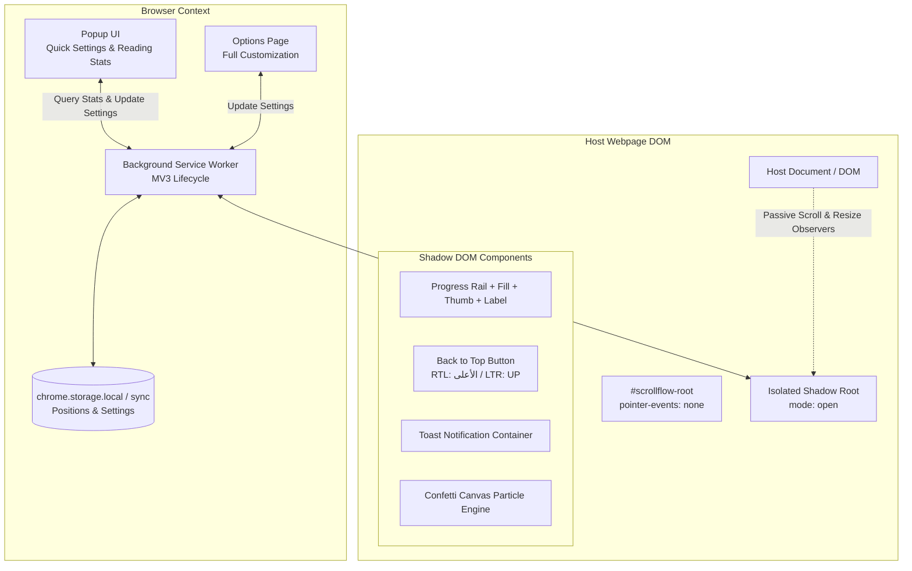

# ScrollFlow — Product Requirements Document (PRD) & System Specification

> **Version:** 1.2  
> **Status:** Approved & Production-Ready  
> **Target Audience:** AI Engineering Agents, Frontend Developers, Extension Architects  
> **Methodology:** Spec-Driven Development (SDD) — Zero runtime dependencies, Zero network calls, Isolated Shadow DOM  

---

## 1. Executive Summary & Vision

**ScrollFlow** is a modern, high-performance Chrome Extension (Manifest V3) that elevates the web reading experience. It provides:
1. **Vertical & Horizontal Reading Progress Bar**: A sleek, non-intrusive floating indicator with customizable themes, geometry, and live percentage display.
2. **Back to Top Floating Action Button**: An intelligent, direction-aware (RTL/LTR) button appearing near the end of the page to smoothly return to the top.
3. **Smart Scroll Position Restoration**: Automatically saves and restores reading positions across tabs and browser restarts without disrupting user navigation.
4. **Milestone Pulses & Celebration Confetti**: Subtle visual micro-interactions at 25%, 50%, and 75%, and a lightweight physics-driven particle burst at 100% completion.
5. **Native Scrollbar Concealment & Smooth Scrolling**: Optional sleek concealment of native OS scrollbars and GPU-composited smooth page scrolling.

### Core Philosophy & Guarantees
- **Zero Runtime Dependencies**: No React, Vue, Svelte, Lodash, or external confetti/animation libraries. Pure native TypeScript + Web APIs.
- **Zero Network Requests**: 100% private, local-only processing. Zero telemetry, zero analytics, zero external API calls.
- **Host Page Isolation**: Complete Shadow DOM encapsulation (`:host { all: initial }`) ensures zero CSS leaking or host page style pollution.
- **Zero Disruption to Host Pages**: All scroll and interaction listeners are strictly `{ passive: true }`. The extension acts as a non-interfering observer.
- **Ultra-Lightweight**: Final bundled build < 35 KB gzipped.

---

## 2. System Architecture & Component Model



### Component Directory Map
```text
scrollflow/
├── manifest.json              # Chrome Manifest V3 declaration
├── package.json               # Development toolchain (Vite, CRXJS, TypeScript, Vitest, Playwright)
├── vite.config.ts             # Bundler configuration
├── tsconfig.json              # Strict TypeScript configuration
├── contracts/                 # Canonical schemas & message types
│   ├── types.ts               # Core domain types
│   ├── messages.ts            # Chrome runtime message contracts
│   └── settings.schema.json   # JSON schema for settings validation
├── _locales/                  # Internationalization (Arabic 'ar', English 'en')
│   ├── ar/messages.json
│   └── en/messages.json
├── src/
│   ├── shared/                # Code shared across background, content, and UI
│   │   ├── types.ts           # Types synchronized with contracts
│   │   ├── messages.ts        # Message type constants
│   │   ├── settings-schema.ts # Validation, default settings, and sanitizers
│   │   └── theme.ts           # Theme token attributes & class mappers
│   ├── core/                  # Pure algorithmic logic (Zero DOM dependencies, 100% unit-tested)
│   │   ├── progress.ts        # Progress calculation & scrollability checks
│   │   ├── back-to-top.ts     # Hysteresis visibility logic & RTL/LTR resolution
│   │   ├── url.ts             # URL normalization and exclusion matching
│   │   ├── storage-model.ts   # TTL (90 days) and LRU (1500 records) pruning
│   │   └── reading.ts         # Reading time and screens estimation
│   ├── content/               # Injected content scripts
│   │   ├── bootstrap.ts       # Content script entry, lifecycle, and scroll loop
│   │   ├── measure.ts         # Layout dimension computation & dynamic height observers
│   │   ├── restore.ts         # Scroll position restoration engine
│   │   ├── milestones.ts      # 25/50/75% pulses and 100% celebration tracker
│   │   └── ui/                # UI components mounted inside Shadow DOM
│   │       ├── shadow-host.ts # Isolated #scrollflow-root host container
│   │       ├── styles.ts      # Complete CSS styles injected into Shadow Root
│   │       ├── progress-bar.ts# Progress bar rail, fill, thumb, label, and scrubbing
│   │       ├── back-to-top.ts # Floating action button component
│   │       ├── native-scroll.ts# Safe native scrollbar concealment
│   │       ├── smooth-scroll.ts# GPU native smooth scroll injection
│   │       ├── toast.ts       # Non-intrusive status toast alerts
│   │       └── confetti.ts    # Lightweight particle physics canvas
│   ├── background/            # Background Service Worker
│   │   ├── service-worker.ts  # Runtime message hub & keyboard shortcut handler
│   │   ├── settings.ts        # Settings persistence and tab synchronization
│   │   ├── store.ts           # Scroll position storage and cleanup
│   │   ├── badge.ts           # Browser icon badge update throttler
│   │   └── nav-watch.ts       # SPA navigation watcher (History API)
│   ├── popup/                 # Toolbar extension popup (340×420px)
│   │   ├── popup.html
│   │   ├── popup.css
│   │   └── popup.ts
│   └── options/               # Full-page options and preferences
│       ├── options.html
│       ├── options.css
│       └── options.ts
└── tests/
    ├── unit/                  # Unit tests for pure core logic (Vitest)
    └── e2e/                   # Integration & browser tests (Playwright)
```

---

## 3. Functional Requirements (FR)

### 3.1 Progress Indicator & Geometry
- **FR-01 (Progress Calculation)**: Accurately calculate page scroll ratio as `scrollY / (docHeight - viewportHeight)`. Must clamp between `0.0` and `1.0`.
- **FR-02 (Short Page Suppression)**: If `maxScroll < viewportHeight * 0.2`, the page is considered non-scrollable; hide the progress bar.
- **FR-03 (Dynamic Height & Infinite Scroll)**: Continuously observe document mutations and window resizing. As content loads dynamically, update the scale without jumping to 100%.
- **FR-04 (Orientation)**: Support **vertical** (fixed right or left) and **horizontal** (fixed top or bottom) progress tracking.
- **FR-05 (Bar Length)**: Support two geometry lengths:
  - `floating`: Centered floating capsule occupying 60% of viewport height/width.
  - `full`: Complete 100% edge-to-edge span across the viewport.
- **FR-06 (Border Radius)**: Support 3 radius styles: `subtle` (6px rounded corners), `pill` (999px fully circular ends), and `sharp` (2px sleek edges).
- **FR-07 (Interactive Scrubbing)**: Users can click and drag the rail/thumb using `PointerCapture`. Dragging smoothly scrolls the host window proportionally.
- **FR-08 (Visual Themes)**: Provide 6 built-in color schemes matching design tokens:
  1. `aurora`: Cosmic purple-to-cyan gradient (`#6d5bff` $\rightarrow$ `#4e8cff` $\rightarrow$ `#00d4ff`).
  2. `sunset`: Warm coral gradient (`#ff416c` $\rightarrow$ `#ff6b6b` $\rightarrow$ `#ffb86b`).
  3. `cyberpunk`: Neon magenta-to-purple gradient (`#ff007f` $\rightarrow$ `#7928ca` $\rightarrow$ `#00f0ff`).
  4. `minimal`: Clean slate monochrome gradient.
  5. `glass`: Frosted translucent capsule with blurred backdrop.
  6. `mono`: Classic neutral gray gradient.
- **FR-09 (High Contrast Mode)**: Provide a high-contrast mode ensuring $\ge 7:1$ track visibility against light or dark web pages.
- **FR-10 (Shadow & Glow Toggle)**: Allow toggling decorative drop shadows and neon thumb glow effects on or off.

### 3.2 Back to Top (UP / الأعلى) Button
- **FR-11 (Trigger Condition)**: The floating "Back to Top" button appears when the user approaches the end of the page:
  - Triggered when `progress >= 0.85` **OR** when remaining scroll distance is $\le 250\text{px}$ (`maxScroll - scrollY <= 250`).
- **FR-12 (Hysteresis & Anti-Flicker)**: The button remains visible until the user scrolls back above `progress < 0.75` (and $> 250\text{px}$ from bottom). This prevents flickering near scroll boundaries.
- **FR-13 (RTL/LTR Directional Intelligence)**:
  - **Arabic / RTL pages**: The button appears at the **bottom-right** (`bottom: 24px; right: 24px; dir="rtl"`), labeled **"الأعلى"** with an upward arrow (⬆).
  - **English / LTR pages**: The button appears at the **bottom-left** (`bottom: 24px; left: 24px; dir="ltr"`), labeled **"UP"** with an upward arrow (⬆).
  - Detection logic inspects `document.documentElement.dir`, `document.body.dir`, `lang` tags (`ar`, `fa`, `he`, `ur`), and computed CSS `direction: rtl`.
- **FR-14 (Smooth Scroll Execution)**: Clicking the button scrolls to the top (`scrollY: 0`) smoothly (`behavior: 'smooth'`), while respecting `prefers-reduced-motion: reduce` (falls back to `'instant'`).

### 3.3 Scroll Position Restoration
- **FR-15 (Automatic Position Saving)**: When user scrolls on a supported page, save `{ url, scrollY, scrollRatio, docHeight, viewportH, ts }` to `chrome.storage.local` after a 400ms debounce.
- **FR-16 (URL Normalization)**: Normalize URLs by stripping tracking queries (`utm_*`, `fbclid`, `ref`, etc.) and non-SPA hash fragments so identical articles share position data.
- **FR-17 (Smart Restoration on Load)**: When revisiting a page within 90 days, restore scroll position if `scrollY >= 60px`.
- **FR-18 (Height Stability Check)**: If the document height has changed by $\le 15\%$ compared to stored height, restore absolute `scrollY`. If height changed $> 15\%$, restore proportionally using `scrollRatio * maxScroll`.
- **FR-19 (User Interaction Safety)**: If the user touches the keyboard, moves mouse wheel, clicks, or taps before restoration completes, **instantly abort restoration** to never fight with active user navigation.
- **FR-20 (Restoration Feedback)**: When scroll is successfully restored, display a subtle toast notification: *"Back to where you left off"* / *"عدت إلى حيث توقفت"*.
- **FR-21 (Storage Pruning)**: Automatically delete records older than 90 days. Cap total stored entries to 1500 using Least Recently Used (LRU) eviction.

### 3.4 Milestones & Celebrations
- **FR-22 (Milestone Pulses)**: When scroll progress crosses 25%, 50%, and 75%, trigger a gentle pulse animation on the progress rail. Each milestone triggers only once per downward pass.
- **FR-23 (Completion Celebration)**: When reaching $\ge 99.5\%$ of the page, trigger a lightweight confetti burst from a viewport-sized canvas in the Shadow DOM.
- **FR-24 (Celebration Rate Limiting)**: Limit confetti celebration to at most once every 60 seconds per tab.
- **FR-25 (Reduced Motion Compliance)**: When `prefers-reduced-motion: reduce` is detected, suppress canvas confetti and pulse animations, falling back to a quiet completion toast.

### 3.5 Native Scrollbar & Smooth Scrolling
- **FR-26 (Native Scrollbar Concealment)**: When enabled, hide native OS scrollbars on `html, body` using:
  ```css
  html, body { scrollbar-width: none !important; -ms-overflow-style: none !important; }
  html::-webkit-scrollbar, body::-webkit-scrollbar { display: none !important; width: 0 !important; height: 0 !important; }
  ```
- **FR-27 (Smooth Scrolling)**: When enabled, apply GPU-composited native smooth scrolling:
  ```css
  @media (prefers-reduced-motion: no-preference) { html { scroll-behavior: smooth; } }
  ```

### 3.6 SPA Navigation & Stability
- **FR-28 (SPA Route Watcher)**: Background worker listens to `chrome.webNavigation.onHistoryStateUpdated` for SPA page changes.
- **FR-29 (In-Page Anchor Safety)**: Do NOT treat reference fragment (`#hash`) updates as page navigations. In-page anchor links must never be overridden or forced to `top: 0`.
- **FR-30 (SPA Reset)**: On true SPA route changes, flush pending saves, reset milestone state, and measure the new page without forcing programmatic scroll.

### 3.7 Extension Popup & Controls
- **FR-31 (Circular Donut Indicator)**: Displays an SVG circular progress ring showing current page reading percentage.
- **FR-32 (Reading Metrics)**: Displays estimated reading time (based on 220 words/minute) and total page length in viewport screens.
- **FR-33 (Per-Site Exclusion)**: One-click button to disable ScrollFlow on the current hostname (added to `blocklist`).
- **FR-34 (Global Settings Sync)**: Settings changes in popup or options page broadcast to all active tabs instantly via `chrome.storage.onChanged`.
- **FR-35 (Data Clearance)**: Button to clear all saved scroll positions while keeping user configuration intact.

---

## 4. Non-Functional Requirements (NFR)

| ID | Category | Requirement Specification |
|---|---|---|
| **NFR-01** | Performance | Scroll event processing must execute within $< 1\text{ms}$ per frame on main thread. All scroll listeners must be `{ passive: true }`. |
| **NFR-02** | Layout Thrashing | Prohibit repeated `window.getComputedStyle()` or `.scrollHeight` calls in tight loops. Cache dimensions and throttle MutationObserver callbacks. |
| **NFR-03** | Isolation | Host element `#scrollflow-root` must have `position: fixed; width: 0; height: 0; pointer-events: none;`. All elements live inside an open ShadowRoot with `:host { all: initial }`. |
| **NFR-04** | Bundle Size | Compiled production package in `dist/` must be $< 35\text{KB}$ gzipped. Zero external runtime packages. |
| **NFR-05** | Memory & Leaks | Clean up all EventListeners, MutationObservers, ResizeObservers, and timers when `destroy()` is called or when navigating away. |
| **NFR-06** | Security | Zero inline script execution. Strict Content Security Policy (`script-src 'self'`). Zero `eval()` or `innerHTML` from untrusted inputs. |
| **NFR-07** | Permissions | Minimum required permissions: `storage`, `activeTab`, `webNavigation` (solely for SPA history state updates). |
| **NFR-08** | Accessibility | Progress bar must expose `role="progressbar"` with `aria-valuemin="0"`, `aria-valuemax="100"`, `aria-valuenow`, and descriptive `aria-label`. Back to Top button must be 100% keyboard-navigable (`Tab`, `Enter`, `Space`) with minimum touch target $\ge 44\times 44\text{px}$. |
| **NFR-09** | Reliability | Wrap all `chrome.runtime.*` and `chrome.storage.*` calls in `try/catch` to fail-soft when tabs close or service workers terminate. |
| **NFR-10** | Internationalization | Support full bilingual localization (`_locales/ar` and `_locales/en`) with native RTL direction support across UI panels and floating widgets. |

---

## 5. Mathematical Models & Algorithms

### 5.1 Progress Ratio
$$\text{maxScroll} = \max(0, \text{docHeight} - \text{viewportHeight})$$
$$\text{progress} = \begin{cases} 0 & \text{if } \text{maxScroll} \le 0 \\ \min\left(1, \max\left(0, \frac{\text{scrollY}}{\text{maxScroll}}\right)\right) & \text{otherwise} \end{cases}$$

### 5.2 Lerp Smoothing
To eliminate micro-stuttering during erratic wheel scrolling, the rendered progress uses Linear Interpolation (Lerp):
$$\text{smoothed}_{t} = \text{smoothed}_{t-1} + (\text{target} - \text{smoothed}_{t-1}) \times 0.28$$
When $|\text{target} - \text{smoothed}| < 0.001$, snap $\text{smoothed} = \text{target}$ and pause `requestAnimationFrame`.

### 5.3 Back to Top Visibility Model
$$\text{remainingPixels} = \text{maxScroll} - \text{scrollY}$$
$$\text{showBackToTop} = \text{scrollable} \land \begin{cases} \text{true} & \text{if } \text{remainingPixels} \le 250 \\ \text{true} & \text{if } \text{currentlyVisible} \land \text{progress} \ge 0.75 \\ \text{true} & \text{if } \neg\text{currentlyVisible} \land \text{progress} \ge 0.85 \\ \text{false} & \text{otherwise} \end{cases}$$

### 5.4 Confetti Particle Physics
Particles are simulated on an unscaled 2D canvas:
- Initial burst: $N = \text{clamp}(60, \lfloor\text{viewportWidth} / 10\rfloor, 140)$ particles.
- Launch position: $x = \text{viewportWidth} - 24$, $y = \text{viewportHeight} \times 0.88$.
- Velocities:
  $$v_x = \text{random}(-12, -2), \quad v_y = \text{random}(-18, -8)$$
- Physics step ($60\text{fps}$):
  $$x_{t} = x_{t-1} + v_x, \quad y_{t} = y_{t-1} + v_y$$
  $$v_y = v_y + \text{gravity} \ (0.45), \quad v_x = v_x \times \text{drag} \ (0.985)$$
  $$\text{rotation} = \text{rotation} + \omega, \quad \text{opacity} = \max(0, 1 - \frac{\text{age}}{\text{lifespan}})$$

---

## 6. Contracts & Data Schemas

### 6.1 Settings Schema (`Settings`)
```typescript
export interface Settings {
  version: 1;
  enabled: boolean;              // Global master toggle
  restoreScroll: boolean;        // Auto-restore previous reading position
  celebrate: boolean;            // Confetti on 100% completion
  milestones: boolean;           // Pulses at 25%, 50%, 75%
  showBadge: boolean;            // Extension icon badge percentage
  showToasts: boolean;           // Non-intrusive status toast notifications
  theme: 'aurora' | 'sunset' | 'cyberpunk' | 'minimal' | 'glass' | 'mono';
  side: 'right' | 'left' | 'auto';
  position: 'right' | 'left' | 'top' | 'bottom';
  orientation: 'vertical' | 'horizontal';
  barLength: 'floating' | 'full';
  barRadius: 'subtle' | 'pill' | 'sharp';
  shadow: boolean;               // Glow and drop shadow toggle
  hideNativeScrollbar: boolean;  // Conceal OS native scrollbar
  smoothScroll: boolean;         // Enable GPU smooth scrolling
  contrast: 'normal' | 'high';   // High-contrast accessibility mode
  allowFileUrls: boolean;        // Support file:// scheme
  blocklist: string[];           // Excluded hostnames
  hiddenOnce: string[];          // Temporarily suppressed URLs
}
```

### 6.2 Scroll Position Entry (`ScrollEntry`)
```typescript
export interface ScrollEntry {
  url: string;                   // Normalized canonical URL
  scrollY: number;               // Pixel scroll offset
  scrollRatio: number;           // 0.0 to 1.0 progress ratio
  docHeight: number;             // Total document height at save time
  viewportH: number;             // Viewport height at save time
  ts: number;                    // Epoch timestamp in milliseconds
}
```

### 6.3 Message Protocol (`Req` / `Res`)
| Message Type | Direction | Payload | Expected Response |
|---|---|---|---|
| `SF_SETTINGS_GET` | Content/Popup $\rightarrow$ Background | `{}` | `{ ok: true, data: Settings }` |
| `SF_SETTINGS_SET` | Content/Popup $\rightarrow$ Background | `{ settings: Partial<Settings> }` | `{ ok: true }` |
| `SF_SETTINGS_CHANGED` | Background $\rightarrow$ All Tabs | `{ settings: Settings }` | Broadcast notification |
| `SF_SAVE_POSITION` | Content $\rightarrow$ Background | `ScrollEntry` | `{ ok: true }` |
| `SF_GET_POSITION` | Content $\rightarrow$ Background | `{ url: string }` | `{ ok: true, data: ScrollEntry \| null }` |
| `SF_PROGRESS_UPDATE` | Content $\rightarrow$ Background | `{ url, percent, scrollable, metrics }` | `{ ok: true }` |
| `SF_NAV_CHANGED` | Background $\rightarrow$ Content | `{ url: string }` | Content resets internal scale |
| `SF_TOGGLE_OVERLAY` | Background $\rightarrow$ Active Tab | `{}` | Toggles temporary visibility |
| `SF_CLEAR_ALL` | Popup $\rightarrow$ Background | `{}` | Wipes all position entries |

---

## 7. Edge Cases & Resilience

1. **Fractional Scaling on High-DPI Displays**: On Windows with 125%/150% scaling, `scrollY + innerHeight` may total `docHeight - 1px`. The Back to Top check and completion tracker use distance tolerances ($\le 250\text{px}$) to guarantee reliable trigger.
2. **Fixed Layout & Overflow Containers (`FR-33`)**: When a web application (e.g. Gmail, Notion, Discord) applies `overflow: hidden` on both `html` and `body` and scrolls internally, ScrollFlow gracefully hides the rail and Back to Top button, reporting *"Page is not measurable"* in the popup.
3. **In-Page Hash Anchors**: Clicks on `<a href="#section">` update fragment references without resetting scroll position to 0 or firing SPA page reload.
4. **Transform on Document Root**: If a website applies CSS `transform` on `document.documentElement`, `position: fixed` breaks. The shadow host detects this via computed styles and falls back to `position: absolute` with passive scroll-synced top positioning.
5. **Incognito / Restricted Storage Access**: If `chrome.storage` is inaccessible, the extension continues rendering the visual progress bar while silently disabling persistence without throwing runtime errors.
